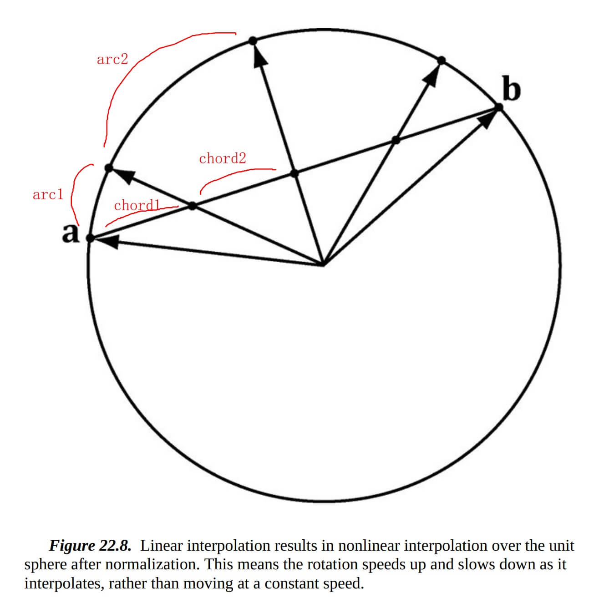
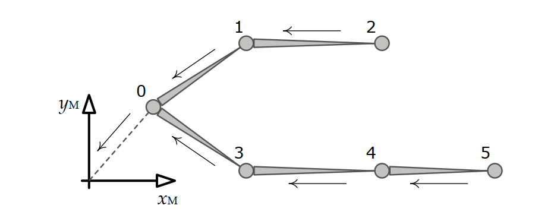

| Documentation  | Linux             | MacOS             | Windows           |       PyPI        |
|      :---:     |       :---:       |       :---:       |       :---:       |       :---:       |
| [![docs][1]][2]| [![rgl-ci][3]][4] | [![rgl-ci][5]][6] | [![rgl-ci][7]][8] | [![pypi][9]][10] |

[1]: https://readthedocs.org/projects/mitsuba/badge/?version=stable
[2]: #readme
[3]: https://rgl-ci.epfl.ch/app/rest/builds/buildType(id:Mitsuba3_LinuxAmd64gcc9)/statusIcon.svg
[4]: #linux
[5]: https://rgl-ci.epfl.ch/app/rest/builds/buildType(id:Mitsuba3_WindowsAmd64msvc2020)/statusIcon.svg
[6]: #macos
[7]: https://img.shields.io/badge/YouTube-View-green?style=plastic&logo=youtube
[8]: #windows
[9]: https://img.shields.io/pypi/v/mitsuba.svg?color=green
[10]: #python

- [Tareas pendientes y problemas](#todo-and-issues)
- [Compilación](#build)
  - [Plataforma](#platform)
  - [Requisitos previos](#prerequisite)
  - [Python](#python)
  - [Opciones de CMake](#cmake-option)
  - [Compilación general](#general-build)
  - [Linux](#linux)
  - [macOS](#macos)
  - [Windows](#windows)
  - [Compilar versión Release](#build-release)
- [Algoritmo](#algorithm)
  - [Sistema de coordenadas (mano derecha)](#coordinate-hand)
  - [Representación de transformaciones](#transform-represent)
  - [Orden de almacenamiento](#storage-order)
  - [Transformaciones en nuestro código](#transform-in-our-code)
  - [Orden de cuaterniones](#quaternion-order)
  - [Interpolación de cuaterniones](#quaternion-interpolation)
  - [Transformación de pose de esqueleto](#skeleton-pose-transform)
  - [Retargeting de raíz](#root-retarget)
  - [Retargeting FK de cadena](#chain-fk-retarget)
  - [Retargeting IK de cadena](#chain-ik-retarget)
  - [Retargeting Pole Match](#pole-match-retarget)
  - [Renderizado de animación de pose de articulaciones](#render-of-joint-pose-animation)
- [Uso](#usage)
  - [Sistema de coordenadas de trabajo](#working-coordinate-system)
  - [Ejemplo en Python](#python-example)
  - [Archivos fuente](#source-files)
  - [Archivos de encabezado](#header-files)
  - [Ejemplo completo](#full-example)
  - [Modelo de entrada](#input-model)
  - [Conversión de CoordType](#coordtype-convert)
  - [Inicialización de USkeleton](#init-of-uskeleton)
  - [Configuración de retargeting de raíz](#root-retarget-config)
  - [Configuración de retargeting de cadena](#chain-retarget-config)
  - [Colocar toda la configuración en IKRigRetargetAsset](#put-config-all-to-ikrigretargetasset)
  - [TPose](#tpose)
  - [Inicialización del procesador](#init-of-processor)
  - [Ejecutar retargeting:](#run-retarget)
- [Desarrollo de características](#feature-work)
- [Notas de lanzamiento](#release-notes)
- [Agradecimientos](#acknowledgements)

<small><i><a href='http://ecotrust-canada.github.io/markdown-toc/'>Tabla de contenidos generada con markdown-toc</a></i></small>


# Tareas pendientes y problemas

0. interpolación de animación

    actualmente se genera cada fotograma,

    se deberían generar únicamente los fotogramas contenidos en la animación de origen

1. enlace Python (Python binding)

    a. copiar dll al paquete

2. parte de IK no implementada

3. SDK de FBX, reemplazar lib assimp

    la importación y exportación de FBX con assimp no es estable

4. parte de renderizado no implementada

    multiplataforma

    RHI de d3d12/vulkan/metal, sin OpenGL


# Compilación

## Plataforma

    1. mac 
    2. linux
    3. windows

    compilador:
    1. clang 17
    2. msvc 17
    3. gcc 17

## Requisitos previos

linux:

    sudo apt-get install zlib1g-dev

## Python

    pip install .
    
    python python/test.py

## Opciones de CMake

    // with assimp project embedded
    -DEMBED_ASSIMP=ON

    // assimp as static lib
    -DBUILD_SHARED_LIBS=OFF

    // release
    --DCMAKE_BUILD_TYPE=Release

## Compilación general

    rm -rf build
    cmake . -B build -DCMAKE_BUILD_TYPE=Release
    cmake --build build --config Release -j 16

    build/test/Release/testikrigretarget.exe

## Linux

    // linux will force -DEMBED_ASSIMP=ON -DBUILD_SHARED_LIBS=ON
    // here use gcc
    
    sudo apt-get install zlib1g-dev

    rm -rf build
    mkdir build && cd build
    cmake .. -DCMAKE_BUILD_TYPE=Release -DEMBED_ASSIMP=ON
    make -j16

## macOS

    rm -rf build
    mkdir build && cd build

    // for xcode project
    cmake .. -GXcode

    // without xcode
    cmake .. --DCMAKE_BUILD_TYPE=Release
    make -j16


## Windows

    rm -rf build
    mkdir build && cd build

    cmake ..
    
    // with visual studio
    open ikrigretarget.sln with visual studio
    set testikrigretarget as start project
    
    // without visual studio
    cmake --build .
    test/Debug/testikrigretarget.exe

## Compilar versión Release
    
    mkdir build && cd build
    cmake .. -DCMAKE_BUILD_TYPE=RELEASE
    make VERBOSE=1

# Algoritmo

## Sistema de coordenadas (mano derecha)

Todos los sistemas de coordenadas son diestros (mano derecha).

## Representación de transformaciones

https://fgiesen.wordpress.com/2012/02/12/row-major-vs-column-major-row-vectors-vs-column-vectors/

referencia:  Arquitectura de Motor de Juego, capítulo 5.3.2

Los puntos y vectores pueden representarse como matrices por fila (1× n) o por columna (n × 1)

Representación por fila:&nbsp;&nbsp;&nbsp; 

$$v1=\begin{bmatrix}x & y & z\end{bmatrix}$$

Representación por columna:&nbsp;&nbsp;&nbsp; 

$$ v2=\begin{bmatrix}
x \\
y \\
z \\
\end{bmatrix} = v1^T $$

La elección entre vectores por columna y por fila afecta el orden de la multiplicación de matrices.

Aplicar matriz a vector:

Vector por fila:&nbsp;&nbsp;&nbsp; $$v1_{1 \times n} = v1_{1 \times n} \times M_{n \times n}$$

Vector por columna:&nbsp;&nbsp;&nbsp; $$v2_{n \times 1} = M_{n \times n} \times v2_{n \times 1}$$

Concatenación de múltiples matrices, aplicar M1 primero, luego M2: 

$$v1 = v1 \times M1 \times M2$$

$$v2 = M2 \times M1 \times v2$$

La representación también afecta el orden de los elementos de la matriz. 

Ejemplo de matriz de traslación para coordenadas homogéneas:

Vector por fila:

$$M_{translation}=
\begin{bmatrix}
1 & 0 & 0 & 0 \\
0 & 1 & 0 & 0 \\
0 & 0 & 1 & 0 \\
tx & ty & tz & 1 \\
\end{bmatrix}$$

Vector por columna:

$$M_{translation}=
\begin{bmatrix}
1 & 0 & 0 & tx \\
0 & 1 & 0 & ty \\
0 & 0 & 1 & tz \\
0 & 0 & 0 & 1 \\
\end{bmatrix}$$


## Orden de almacenamiento

La matriz puede almacenarse en formato row-major (por fila) o col-major (por columna).

El orden de almacenamiento no afecta la representación, pero sí afecta el orden de los elementos en memoria.

Para acceder a un elemento:

Almacenamiento por fila:  m[row][col]

Almacenamiento por columna:  m[col][row]

## Transformaciones en nuestro código

    SoulScene.h
        glm::mat4/glm::dmat4:
            hand        : right hand
            represent   : col vector
            store order : col major
        
    SoulFTransform SoulRetargeter.h SoulIKRetargetProcessor.h
        https://docs.unrealengine.com/4.27/en-US/API/Runtime/Core/Math/FTransform/
        Here we keep Unreal represent, but use right hand
        Unreal FTransform 
            hand        : right hand
            represent   : row vector
            store order : row major

    lib ASSIMP
        aiMatrix4x4:
            hand        : right hand
            represent   : col vector
            store order : row major

## Orden de cuaterniones

Orden de todos los cuaterniones: la derecha es la primera.

## Interpolación de cuaterniones

SLERP es la interpolación lineal sobre el arco de la esfera unitaria 4D.

FastLerp es la interpolación lineal sobre la cuerda de la esfera unitaria 4D.

Debido a que el mapeo entre cuerda y arco no es uniforme, FastLerp provocará velocidades desiguales en cada paso de tiempo.

[](./img/slerp.jpg)

## Transformación de pose de esqueleto

referencia:  arquitectura de motor de juego, capítulo 12.3.3

    
Espacio local de la articulación: el espacio de la articulación.

Espacio global: en el espacio mundial o del modelo, como no nos importa la transformación fuera del modelo, elegimos el espacio del modelo.

Para transformar una pose local a una pose global (espacio del modelo), basta con recorrer la jerarquía del esqueleto desde la articulación actual hasta la raíz.

Denotar la transformación del espacio local de la articulación j a su espacio padre:

$$P_{j->p(j)}$$

Representación por fila:  

$$P_{5->M} = P_{5->4} \times P_{4->3} \times P_{3->0} \times P_{0->M}$$

Representación por columna:

$$P_{5->M} =  P_{0->M} \times P_{3->0} \times P_{4->3} \times P_{5->4} $$




## Retargeting de raíz
Retargeting de raíz: retargeting de posición mediante la relación de altura.

    init:
        source.InitialHeightInverse = 1/ root.z
        target.initialHeight = root.z
    retarget:
        target.root.translation = source.root.translation *  target.initialHeight * source.InitialHeightInverse

## Retargeting FK de cadena
Retargeting FK de cadena: copiar delta de rotación global.

    init:
        foreach chain:
            foreach joint:
                record initialPoseGlobal, initialPoseLocal
                reset currentPoseGlobal
    retarget(inputPoseGlobal, outposeGlobal):
        foreach chain:
            foreach joint:

                // apply parent transform to child to get position
                currentPositionGlobal = apply parrent.currentPoseGlobal to initialPoseLocal

                // copy global rotation delta
                deltaRotationGlobal = inputPoseGlobal.currentRotationGlboal / source.initalRotationGlboal
                currentRotationGlboal = initialRotationGlobal * deltaRotationGlobal

                // copy global scale delta
                currentScaleGlobal = TargetInitialScaleGlobal + (SourceCurrentScaleGlobal - SourceInitialScaleGlobal);

                // pose from position and rotation
                currentPoseGlobal = (currentPositionGlobal, currentRotationGlboal)
                outposeGlobal[boneIndex] =  currentPoseGlobal

## Retargeting IK de cadena
    // chain IK retarget
    todo

## Retargeting Pole Match
    // pole match retarget
    todo

## Renderizado de animación de pose de articulaciones

Aquí usamos representación de vector por columna.

https://github.com/KhronosGroup/glTF-Tutorials/blob/master/gltfTutorial/gltfTutorial_020_Skins.md


jointMat y animación de pose:

    jointMatrix(j) = globalTransformOfJointNode(j) * inverseBindPoseMatrixForJoint(j);


    currentpose.position = globalTransformOfJointNode * inverseBindPoseMatrixForJoint * bindpose.position
        bindpose.position: bind pose vertex world position 
        currentpose.position: current pose vertex world position
        inverseBindPoseMatrixForJoint: world space to joint local space of bind pose
        globalTransformOfJointNode: joint local space to world space of current pose


Transformación global:

    for joint from root to leaf:
        globalTransformOfJointNode = parentGlobal * childLocal


Sombreador de piel (skin shader): posición promedio de varias articulaciones.

    ...
    attribute vec4 a_joint;
    attribute vec4 a_weight;

    uniform mat4 u_jointMat[JOINT_NUM];

    ...
    void main(void)
    {
        mat4 skinMat =
            a_weight.x * u_jointMat[int(a_joint.x)] +
            a_weight.y * u_jointMat[int(a_joint.y)] +
            a_weight.z * u_jointMat[int(a_joint.z)] +
            a_weight.w * u_jointMat[int(a_joint.w)];
        vec4 worldPosition = skinMat * vec4(a_position,1.0);
        vec4 cameraPosition = u_viewMatrix * worldPosition;
        gl_Position = u_projectionMatrix * cameraPosition;
    }

# Uso

## Sistema de coordenadas de trabajo
    mano derecha
    z arriba, x izquierda, y frontal

    frontal: hacia el usuario de la pantalla
    trasero: lejos del usuario de la pantalla

## Ejemplo en Python

```python

import sys, os
import ikrigretarget as ir

def config_gpt_meta():

    config = ir.SoulIKRigRetargetConfig()

    config.SourceCoord      = ir.CoordType.RightHandZupYfront
    config.WorkCoord        = ir.CoordType.RightHandZupYfront
    config.TargetCoord      = ir.CoordType.RightHandYupZfront

    config.SourceRootType   = ir.ERootType.RootZMinusGroundZ
    config.TargetRootType   = ir.ERootType.RootZ

    config.SourceRootBone   = "Pelvis"
    config.SourceGroundBone = "Left_foot"
    config.TargetRootBone   = "Rol01_Torso01HipCtrlJnt_M"
    config.TargetGroundBone = "Rol01_Leg01FootJnt_L"


    ### source chain
    # name         start                 end
    config.SourceChains = [
        ir.SoulIKRigChain("spine",       "Spine1",             "Spine3"),
        ir.SoulIKRigChain("head",        "Neck",               "Head"),
    ]

    ...

    ### target chain
    config.TargetChains.append(ir.SoulIKRigChain("spine",       "Rol01_Torso0102Jnt_M",             "Rol01_Neck0101Jnt_M"))
    config.TargetChains.append(ir.SoulIKRigChain("head",        "Rol01_Neck0102Jnt_M",              "Head_M"))
    ...

    ### chain mapping
    config.ChainMapping.append(ir.SoulIKRigChainMapping(True,  False,  "spine",        "spine"))
    config.ChainMapping.append(ir.SoulIKRigChainMapping(True,  False,  "head",         "head"))

    ...

    return config


if __name__ == "__main__":
    
    config = config_gpt_meta()
    print(config)

    srcAnimationFile = "gpt_motion_smpl.fbx"
    srcTPoseFile = "GPT_T-Pose.fbx"
    targetFile = "3D_Avatar2_Rig_0723.fbx"
    targetTPoseFile = "3D_Avatar2_Rig_0723_itpose.fbx"
    outFile = "out.fbx"

    ret = ir.retargetFBX(srcAnimationFile, srcTPoseFile, config.SourceRootBone, targetFile, targetTPoseFile, outFile, config)
    print(ret)
```

## Archivos fuente

    lib         // retarget implement
    lib/glm     // thirdParty files, need remove if already exist in your project
    test        // test project, including fbx file read write

## Archivos de encabezado

    SoulRetargeter.h                // define retarget asset
    SoulIKRetargetProcessor.h       // retarget processor
    IKRigUtils.h                    // config define, utils for pose convert, coord system convert...
    SoulScene.h                     // scene, mesh, skeleton, animation define

## Ejemplo completo

main.cpp

```cpp
#include "SoulScene.h"
#include "SoulRetargeter.h"
#include "SoulIKRetargetProcessor.h"
#include "IKRigUtils.hpp"
#include "FBXRW.h"

/////////////////////////////////////////////
// config
TestCase testCase       = case_Flair();
auto config             = testCase.config;
CoordType srccoord      = config.SourceCoord;
CoordType workcoord     = config.WorkCoord;
CoordType tgtcoord      = config.TargetCoord;

/////////////////////////////////////////////
// read fbx
std::string srcAnimationFile, srcTPoseFile, targetFile, targetTPoseFile, outfile;
getFilePaths(srcAnimationFile, srcTPoseFile, targetFile, targetTPoseFile, outfile, testCase);

SoulIK::FBXRW fbxSrcAnimation, fbxSrcTPose, fbxTarget, fbxTargetTPose;
fbxSrcAnimation.readPureSkeletonWithDefualtMesh(srcAnimationFile, config.SourceRootBone);
if(srcAnimationFile == srcTPoseFile) {
    fbxSrcTPose = fbxSrcAnimation;
} else {
    fbxSrcTPose.readPureSkeletonWithDefualtMesh(srcTPoseFile, config.SourceRootBone);
}
fbxTarget.readSkeletonMesh(targetFile);
if (targetFile == targetTPoseFile) {
    fbxTargetTPose = fbxTarget;
} else {
    fbxTargetTPose.readSkeletonMesh(targetTPoseFile);
}

SoulIK::SoulScene& srcscene         = *fbxSrcAnimation.getSoulScene();
SoulIK::SoulScene& srcTPoseScene    = *fbxSrcTPose.getSoulScene();
SoulIK::SoulScene& tgtscene         = *fbxTarget.getSoulScene();
SoulIK::SoulScene& tgtTPosescene    = *fbxTargetTPose.getSoulScene();
SoulIK::SoulSkeletonMesh& srcskm    = *srcscene.skmeshes[0];
SoulIK::SoulSkeletonMesh& tgtskm    = *tgtscene.skmeshes[0];

/////////////////////////////////////////////
// init
SoulIK::USkeleton srcusk;
SoulIK::USkeleton tgtusk;
IKRigUtils::getUSkeletonFromMesh(srcTPoseScene, *srcTPoseScene.skmeshes[0], srcusk, srccoord, workcoord);
IKRigUtils::alignUSKWithSkeleton(srcusk, srcskm.skeleton);
IKRigUtils::getUSkeletonFromMesh(tgtTPosescene, *tgtTPosescene.skmeshes[0], tgtusk, tgtcoord, workcoord);
IKRigUtils::alignUSKWithSkeleton(tgtusk, tgtskm.skeleton); 

SoulIK::UIKRetargetProcessor ikretarget;
auto InRetargeterAsset = createIKRigAsset(config, srcskm.skeleton, tgtskm.skeleton, srcusk, tgtusk);
ikretarget.Initialize(&srcusk, &tgtusk, InRetargeterAsset.get(), false);

/////////////////////////////////////////////
// build pose animation
std::vector<SoulIK::SoulPose> inposes;
std::vector<SoulIK::SoulPose> outposes;
... 

/////////////////////////////////////////////
// run retarget
for(int frame = 0; frame < inposes.size(); frame++) {
    // type cast
    IKRigUtils::SoulPose2FPose(inposes[frame], inposeLocal);

    // coord convert
    IKRigUtils::LocalPoseCoordConvert(tsrc2work, inposeLocal, srccoord, workcoord);

    // to global pose
    IKRigUtils::FPoseToGlobal(srcskm.skeleton, inposeLocal, inpose);

    // retarget
    std::vector<FTransform>& outpose = ikretarget.RunRetargeter(inpose, SpeedValuesFromCurves, DeltaTime);
    
    // to local pose
    IKRigUtils::FPoseToLocal(tgtskm.skeleton, outpose, outposeLocal);
    
    // coord convert
    IKRigUtils::LocalPoseCoordConvert(twork2tgt, outposeLocal, workcoord, tgtcoord);

    // type cast
    IKRigUtils::FPose2SoulPose(outposeLocal, outposes[frame]);
}

/////////////////////////////////////////////
// write animation to fbx
...
```

## Modelo de entrada

```cpp
source animation    : including skeleton animation
source tpose        : tpose skeleton for source animation model
target animation    : save animation based on this model
target tpose        : tpose skeleton for target animation model


because animation model and tpose model may have different skeleton order
so need align them:

IKRigUtils::alignUSKWithSkeleton(sourceTPoseUSKeleton, sourceAnimationSkeletonMesh.skeleton);
```

## Conversión de CoordType

```cpp
enum class CoordType: uint8_t {
    RightHandZupYfront,
    RightHandYupZfront,
};

wording coord   : CoordType::RightHandZupYfront
from maya       : CoordType::RightHandYupZfront
```

## Inicialización de USkeleton

```cpp
class USkeleton {
    std::string name;
    std::vector<FBoneNode> boneTree;    // each item name and parentId
    std::vector<FTransform> refpose;    // coord: Right Hand Z up Y front, local
    ...
};
struct FBoneNode {
    std::string name;                   // joint name
    int32_t parent;                     // joint tree relationship
    ...
};
```

## Configuración de retargeting de raíz

```cpp
1. define root type
2. define root name
3. if need ground bone, define ground bone type

enum class ERootType: uint8_t {
    RootZ = 0,          // height = root.translation.z
    RootZMinusGroundZ,  // height = root.translation.z - ground.translation.z
    Ignore              // skip
};

// root
ERootType   SourceRootType{ERootType::RootZMinusGroundZ};
std::string SourceRootBone;
std::string SourceGroundBone;
ERootType   TargetRootType{ERootType::RootZMinusGroundZ};
std::string TargetRootBone;
std::string TargetGroundBone;
```

## Configuración de retargeting de cadena

```cpp
1. source skeleton define many chains
2. target skeleton define may chains
3. define chain mapping

struct SoulIKRigChain {
    std::string chainName;
    std::string startBone;
    std::string endBone;
};
struct SoulIKRigChainMapping {
    bool EnableFK{true};
    bool EnableIK{false};
    std::string SourceChain;
    std::string TargetChain;
};

std::vector<SoulIKRigChain> SourceChains;
std::vector<SoulIKRigChain> TargetChains;
std::vector<SoulIKRigChainMapping> ChainMapping;
```

## Colocar toda la configuración en IKRigRetargetAsset

```cpp
/////////////////////////////////////////////
// define config
struct SoulIKRigRetargetConfig {
    struct SoulIKRigChain {
        std::string chainName;
        std::string startBone;
        std::string endBone;
    };
    struct SoulIKRigChainMapping {
        bool EnableFK{true};
        bool EnableIK{false};
        std::string SourceChain;
        std::string TargetChain;
    };

    // coordinate system
    CoordType SourceCoord;
    CoordType WorkCoord{CoordType::RightHandZupYfront};
    CoordType TargetCoord;

    // root
    ERootType   SourceRootType{ERootType::RootZMinusGroundZ};
    std::string SourceRootBone;
    std::string SourceGroundBone;
    ERootType   TargetRootType{ERootType::RootZMinusGroundZ};
    std::string TargetRootBone;
    std::string TargetGroundBone;

    std::vector<SoulIKRigChain> SourceChains;
    std::vector<SoulIKRigChain> TargetChains;
    std::vector<SoulIKRigChainMapping> ChainMapping;
};

// then create Asset with config
asset = createIKRigAsset(SoulIKRigRetargetConfig& config,
                SoulSkeleton& srcsk, SoulSkeleton& tgtsk,
                USkeleton& srcusk, USkeleton& tgtusk);


/////////////////////////////////////////////
// example config:

SoulIKRigRetargetConfig config;
config.SourceCoord      = CoordType::RightHandZupYfront;
config.WorkCoord        = CoordType::RightHandZupYfront;
config.TargetCoord      = CoordType::RightHandYupZfront;

config.SourceRootType   = ERootType::RootZMinusGroundZ;
config.TargetRootType   = ERootType::RootZ;

config.SourceRootBone   = "mixamorig:Hips";
config.SourceGroundBone = "mixamorig:LeftToe_End";
config.TargetRootBone   = "Rol01_Torso01HipCtrlJnt_M";
config.TargetGroundBone = "Rol01_Leg01FootJnt_L";

//config.skipRootBone = true;

config.SourceChains = {
    // name     start               end
    // spine
    {"spine",   "Spine",            "Thorax"},

    // head
    {"head",    "Neck",             "Head"},

    //{"lleg",    "LeftHip",          "LeftAnkle"},
    {"lleg1",   "LeftHip",          "LeftHip"},
    {"lleg2",   "LeftKnee",         "LeftKnee"},
    {"lleg3",   "LeftAnkle",        "LeftAnkle"},

    //{"rleg",    "RightHip",         "RightAnkle"},
    {"rleg1",   "RightHip",         "RightHip"},
    {"rleg2",   "RightKnee",        "RightKnee"},
    {"rleg3",   "RightAnkle",       "RightAnkle"},

    //{"larm",    "LeftShoulder",     "LeftWrist"},
    {"larm1",   "LeftShoulder",     "LeftShoulder"},
    {"larm2",   "LeftElbow",        "LeftElbow"},
    {"larm3",   "LeftWrist",        "LeftWrist"},
    
    //{"rram",    "RightShoulder",    "RightWrist"},
    {"rram1",   "RightShoulder",    "RightShoulder"},
    {"rram2",   "RightElbow",       "RightElbow"},
    {"rram3",   "RightWrist",       "RightWrist"},

};

config.TargetChains = {
    // name    start        end
    // spine
    {"spine",   "Rol01_Torso0102Jnt_M",     "Rol01_Neck0101Jnt_M"},

    // head
    {"head",    "Rol01_Neck0102Jnt_M",      "Head_M"},

    //{"lleg",    "Rol01_Leg01Up01Jnt_L",     "Rol01_Leg01AnkleJnt_L"},
    {"lleg1",   "Rol01_Leg01Up01Jnt_L",     "Rol01_Leg01Up01Jnt_L"},
    {"lleg2",   "Rol01_Leg01Low01Jnt_L",    "Rol01_Leg01Low01Jnt_L"},
    {"lleg3",   "Rol01_Leg01AnkleJnt_L",    "Rol01_Leg01AnkleJnt_L"},

    //{"rleg",    "Rol01_Leg01Up01Jnt_R",     "Rol01_Leg01AnkleJnt_R"},
    {"rleg1",   "Rol01_Leg01Up01Jnt_R",     "Rol01_Leg01Up01Jnt_R"},
    {"rleg2",   "Rol01_Leg01Low01Jnt_R",    "Rol01_Leg01Low01Jnt_R"},
    {"rleg3",   "Rol01_Leg01AnkleJnt_R",    "Rol01_Leg01AnkleJnt_R"},

    //{"larm",    "Rol01_Arm01Up01Jnt_L",     "Rol01_Arm01Low03Jnt_L"},
    {"larm1",   "Rol01_Arm01Up01Jnt_L",     "Rol01_Arm01Up01Jnt_L"},
    {"larm2",   "Rol01_Arm01Low01Jnt_L",    "Rol01_Arm01Low01Jnt_L"},
    {"larm3",   "Rol01_Hand01MasterJnt_L",  "Rol01_Hand01MasterJnt_L"},

    //{"rram",    "Rol01_Arm01Up01Jnt_R",    "Rol01_Arm01Low03Jnt_R"},
    {"rram1",   "Rol01_Arm01Up01Jnt_R",     "Rol01_Arm01Up01Jnt_R"},
    {"rram2",   "Rol01_Arm01Low01Jnt_R",    "Rol01_Arm01Low01Jnt_R"},
    {"rram3",   "Rol01_Hand01MasterJnt_R",  "Rol01_Hand01MasterJnt_R"},        
};

config.ChainMapping = {
    // fk   ik      sourceChain     targetChain
    
    // spine
    {true,  false,  "spine",        "spine"},

    // head
    {true,  false,  "head",         "head"},

    // lleg
    {true,  false,  "lleg1",        "lleg1"},
    {true,  false,  "lleg2",        "lleg2"},
    {true,  false,  "lleg3",        "lleg3"},
    
    // rleg
    {true,  false,  "rleg1",        "rleg1"},
    {true,  false,  "rleg2",        "rleg2"},
    {true,  false,  "rleg3",        "rleg3"},

    // larm
    {true,  false,  "larm1",        "larm1"},
    {true,  false,  "larm2",        "larm2"},
    {true,  false,  "larm3",        "larm3"},
    
    // rarm
    {true,  false,  "rram1",        "rram1"},
    {true,  false,  "rram2",        "rram2"},
    {true,  false,  "rram3",        "rram3"},
};
```

## TPose

    es mejor que tanto el origen como el destino tengan la pose inicial en tpose

    pero otras poses iniciales también están bien

    regla: pose inicial de origen == pose inicial de destino

## Inicialización del procesador

    SoulIK::UIKRetargetProcessor ikretarget;
    ikretarget.Initialize(&srcusk, &tgtusk, asset, false);    

## Ejecutar retargeting:

```cpp
// type cast
IKRigUtils::SoulPose2FPose(inposes[frame], inposeLocal);

// coord convert
IKRigUtils::LocalPoseCoordConvert(tsrc2work, inposeLocal, srccoord, workcoord);

// to global pose
IKRigUtils::FPoseToGlobal(srcskm.skeleton, inposeLocal, inpose);

// retarget
std::vector<FTransform>& outpose = ikretarget.RunRetargeter(inpose, SpeedValuesFromCurves, DeltaTime);

// to local pose
IKRigUtils::FPoseToLocal(tgtskm.skeleton, outpose, outposeLocal);

// coord convert
IKRigUtils::LocalPoseCoordConvert(twork2tgt, outposeLocal, workcoord, tgtcoord);

// type cast
IKRigUtils::FPose2SoulPose(outposeLocal, outposes[frame]);
```

# Desarrollo de características

desarrollar un complemento de Maya basado en esta librería

renderizar el esqueleto y la animación para facilitar la depuración

# Notas de lanzamiento

versión 1.1.4: 2023.5.24:

    corregir error para linux y gcc

versión 1.1.3: 2023.4.20:

    el enlace Python permite asignar una lista de Python a un std::vector de C++

    método 1:
    config.SourceChains.append(chain1)
    config.SourceChains.append(chain2)

    método 2:
    config.SourceChains = [chain1, chain2]


versión 1.1.2: 2023.4.20

    agregar compilación para linux

versión 1.1.1: 2023.4.20

    corregir salto de animación:  muchos tiempos flotantes dentro de un fotograma,  interpolados por alpha flotante.

versión 1.1.0: 2023.4.19

    1. corregir alineación de uskeleton tpose con el esqueleto de animación: error durante la escala desde la articulación raíz hasta la raíz mundial, diferente
    2. enlace Python

versión 1.0.4: 2023.4.14

    1. actualizar lib assimp para macos
    2. corregir error en macos:
        error de targetBoneIndex al crear createIKRigAsset
        error de ordenamiento de cadenas en SoulIKRetargetProcessor: 
            std::sort(ChainPairsFK.begin(), ChainPairsFK.end(), ChainsSorter);

            return A.TargetBoneChainName.compare(B.TargetBoneChainName) <= 0;
            =>
            return A.TargetBoneChainName.compare(B.TargetBoneChainName) < 0;
    3. cambiar /lib a /code
    4. eliminar proyecto assimp incrustado si no es -DEMBED_ASSIMP=ON

versión 1.0.3: 2023.4.13

    corregir salto de animación:  cuaternión no normalizado.

versión 1.0.2: 2023.4.12

    corregir retargeting flair a meta:  cambiar coordtype y rootBoneName

    agregar ERootType:
        RootZ               : height = root.translation.z
        RootZMinusGroundZ   : height = root.translation.z - ground.translation.z
        Ignore              : omitir retargeting de raíz

versión 1.0.1: 2023.4.12

    archivo de entrada:  sourceAnimation sourceTPose targetAnimation targetTPose
        es necesario alinear uskeleton tpose con el esqueleto de animación
    agregar struct testcase

    corregir conversión de coordtype de uskeleton
    corregir alineación de pose tpose y animación

    agregar soporte para macos con lib assimp en release
    windows cambiar assimp de debug a release

versión 1.0.0: 2023.4.10:
    leer archivo fbx de animación de origen
    leer archivo fbx de tpose de origen
    leer archivo fbx meta de destino

    ejecutar retargeting desde animación de origen a archivo meta de destino

    config de retargeting:
        s1 a meta
        flair a meta

# Agradecimientos

este repositorio se copia de   https://github.com/EpicGames/UnrealEngine

ruta:  Engine/Plugins/Animation/IKRig

uso glm para implementar las matemáticas de Unreal, y mantengo el sistema de coordenadas diestro, z arriba, y frontal

esto difiere de Unreal, que es zurdo, z arriba, y frontal
